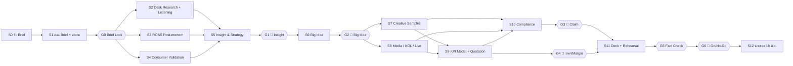

# ชิ้นที่ 1 — AI Workflow ของทีม TPS
## งาน Pitch แคมเปญพิเศษ 3 เดือน · ซีเล็ค ทูน่าสเต็กในน้ำแร่ (Thai Union Group)

> ผู้จัดทำ: Sales Manager (Account Lead / เจ้าของโปรเจกต์) · วันรับ Brief: อ. 3 พ.ย. 2569 · วันนำเสนอ: **พ. 18 พ.ย. 2569** (12 วันทำการ)
> หมายเหตุ: ตัวเลขยอดขาย สเปกสินค้า และผู้ติดต่อในโจทย์เป็น **ข้อมูลสมมติ** และทุกชิ้นงานต้องติดป้ายแยกจากข้อมูลสาธารณะ (ดูข้อ 6.3)

---

## 0. สรุปสำหรับผู้บริหาร

| หัวข้อ | สาระ |
|---|---|
| หลักการ | **AI ร่าง / คนตัดสิน / มีหลักฐานทุกตัวเลข** ให้ AI เร่งงานวิจัย วิเคราะห์ข้อมูล และทำร่างแรก ส่วนการเลือก Insight, Big Idea, Claim, ตัวเลขเชิงพาณิชย์ และการยื่นงาน ต้องเป็นคนตัดสินเสมอ |
| โครงสร้าง | 13 ขั้นตอน (S0–S12) · ด่านตรวจงาน 7 ด่าน (G0–G6) · จุดที่คนต้องตัดสิน 💎 6 จุด |
| Manhour | ใช้ AI **224 ชม.** เทียบกับไม่ใช้ AI 359 ชม. (**ลดลง 37.6%**) · ต้นทุนคนราว 258,800 บาท · เพดานต้นทุน Pitch ไม่เกิน 300,000 บาท |
| KPI สูงสุดของทีม | ได้งาน (Win) · Compliance Defect ในเด็คสุดท้าย = **0** · ตัวเลขที่ไม่มีแหล่งอ้างอิง = **0** · Manhour คลาดเคลื่อนไม่เกิน ±10% |
| ความเสี่ยงหลัก | (1) AI แต่งข้อมูล/ตัวเลขขึ้นมาเอง (Hallucination) (2) Copy จาก AI ละเมิดข้อห้ามของลูกค้าหรือกฎหมาย (3) ข้อมูลลับของลูกค้ารั่วผ่านเครื่องมือ AI |

---

## 1. หลักการทำงาน 5 ข้อ

1. **Brief Lock ก่อนเริ่ม** ข้อห้าม 6 ข้อของลูกค้าจะกลายเป็น "Guardrail Prompt" ที่ใส่ในทุก Prompt และเป็น Checklist ประจำทุกด่าน
2. **Maker → Checker → Approver** งานทุกชิ้นมีผู้ทำ ผู้ตรวจ และผู้อนุมัติที่เป็นคนละคนกัน AI ทำได้แค่ช่วย Maker หรือเป็น Pre-checker เท่านั้น และไม่นับเป็น Checker
3. **ทุกตัวเลขต้องมีที่มา** ทุกตัวเลขในเด็คต้องมีป้ายแหล่งข้อมูล [P]/[C]/[A] และในเด็คสุดท้ายต้องไม่เหลือป้าย [AI] ค้างอยู่
4. **ข้อมูลลูกค้าใช้กับ AI ระดับองค์กรเท่านั้น** ใช้บัญชี Team/Enterprise ที่ปิดการนำข้อมูลไปเทรนโมเดล ห้ามใส่ลงบัญชีส่วนตัว
5. **บันทึกทุกชั่วโมงและทุกการใช้ AI** ลง Timesheet และ AI Log ด้วยรหัสขั้นตอน (เช่น `SEA-S07`) เพื่อวัด Manhour และเก็บเป็นบทเรียนรอบต่อไป

---

## 2. ทีมและบทบาท

| รหัส | บทบาท | หน้าที่หลักในงานนี้ | ทำงานกับ AI อย่างไร |
|---|---|---|---|
| **SM** | Sales Manager / Account Lead (ผู้จัดทำ) | เจ้าของโปรเจกต์ คุยกับลูกค้า ล็อก Brief ทำ Quotation และเงื่อนไขการค้า คุมเวลาและ Manhour เป็นผู้นำเสนอหลัก | ใช้ AI ถอดความ Brief ร่างคำถามถึงลูกค้า และร่างโครงสร้าง Quotation |
| **SP** | Strategic Planner | หา Insight หาโอกาสในการกิน (Occasion) วางกลยุทธ์ และทำ Consumer Validation | ใช้ AI ทำ Deep Research สรุป Social Listening และร่าง Strategy |
| **DA** | Data & Performance Analyst | วิเคราะห์ว่า ROAS ของแคมเปญรอบก่อนตกเพราะอะไร คำนวณยอดต่อสาขาต่อสัปดาห์ และทำ KPI Model | ใช้ AI ช่วยเขียนสูตรหรือโค้ด และหาความผิดปกติในข้อมูล (Anomaly) |
| **MP** | Media Planner | วางแผน Media ภายใต้งบ 1.2 ลบ. และกำหนด Flighting กับ Frequency Cap | ใช้ AI จำลองการกระจายงบ (Scenario) |
| **KL** | KOL & Live Commerce Lead | คัด KOL ทำ Rundown การ Live และวางแผน Shopee/Lazada/TikTok Shop | ใช้ AI คัดรายชื่อ KOL ตรวจผู้ติดตามปลอม และร่าง Script Live |
| **CD** | Creative Director | คุม Big Idea และคุณภาพงานสร้างสรรค์ | ใช้ AI ขยายมุมคิด แต่คนเป็นผู้เลือกไอเดีย |
| **CW** | Copywriter | Headline, Caption, Script | ใช้ AI ร่างหลายเวอร์ชันแล้วคนเกลา |
| **AD** | Art Director / Designer | KV, Mock-up, Storyboard, เด็ค | ใช้ AI ทำ Moodboard, ฉากหลัง และ Animatic โดยภาพกระป๋องต้องเป็นของจริงเท่านั้น |
| **AE** | Account Executive / PMO | ทำ Timeline, Timesheet, AI Log, Version Control และ Fact Log | ใช้ AI สรุปการประชุมและติดตามงาน |
| **QC** | Brand Safety & Compliance Reviewer (Legal/Senior) | ตรวจ Claim, ข้อห้าม, การติดป้าย AI และลิขสิทธิ์ | ใช้ AI สแกนคำต้องห้ามรอบแรกเท่านั้น คนเป็นผู้ตัดสินขั้นสุดท้าย |
| **MD** | Managing Director | อนุมัติตามด่าน (Gate Approver) อนุมัติราคาและ Margin และตัดสินใจ Go/No-Go | ไม่ใช้ AI ในการอนุมัติ |

### RACI ของการตัดสินใจหลัก (R = ผู้ทำ, A = ผู้อนุมัติ, C = ผู้ให้ความเห็น, I = ผู้รับทราบ)

| การตัดสินใจ | SM | SP | DA | MP | KL | CD | QC | MD |
|---|---|---|---|---|---|---|---|---|
| Brief Lock และคำถามถึงลูกค้า | **R/A** | C | C | C | I | C | C | I |
| สาเหตุที่ ROAS ตก | C | I | **R** | C | I | I | I | **A** |
| Insight / Occasion | C | **R** | C | I | I | C | I | **A** |
| Big Idea | C | C | I | I | I | **R** | C | **A** |
| Claim / Copy ผ่าน Compliance | C | I | I | I | C | C | **R/A** | I |
| แบ่งงบ Media / KOL / Live | C | C | C | **R** | **R** | I | I | **A** |
| Quotation, Margin, เงื่อนไขชำระเงิน | **R** | I | C | C | C | I | I | **A** |
| Go/No-Go ยื่นงาน | **R** | C | C | C | C | C | C | **A** |

---

## 3. Timeline (12 วันทำการ)

| สัปดาห์ | อ. 3 | พ. 4 | พฤ. 5 | ศ. 6 | จ. 9 | อ. 10 | พ. 11 | พฤ. 12 | ศ. 13 | จ. 16 | อ. 17 | พ. 18 |
|---|---|---|---|---|---|---|---|---|---|---|---|---|
| S0–S1 Brief | ■ | ■ G0 | | | | | | | | | | |
| S2 Research | | ■ | ■ | ■ | | | | | | | | |
| S3 ROAS Post-mortem | | ■ | ■ | ■ | ■ | | | | | | | |
| S4 Consumer Validation | | | ■ | ■ | ■ | | | | | | | |
| S5 Insight & Strategy | | | | | ■ | ■ G1💎 | | | | | | |
| S6 Big Idea | | | | | | ■ | ■ G2💎 | | | | | |
| S7 Creative Samples | | | | | | | | ■ | ■ | ■ | | |
| S8 Media/KOL/Live | | | | | | | ■ | ■ | ■ | ■ | | |
| S9 KPI Model & Quotation | | | | | | | | | ■ | ■ G4💎 | | |
| S10 Compliance | | | | | | | | | | ■ G3💎 | | |
| S11 Deck & Rehearsal | | | | | | | | | | | ■ G5/G6💎 | |
| S12 Present | | | | | | | | | | | | ■ |

Buffer: เย็นวัน จ. 16 – เช้าวัน อ. 17 กันไว้แก้งานหลัง Compliance หากล่าช้า ให้ตัดจำนวน Creative Sample ลง ห้ามตัดขั้นตอน Compliance

---

## 4. AI Workflow ทีละขั้น (รับ Brief → วันนำเสนอ)

### ตารางหลัก

| ขั้น | วันที่ | งาน | AI ที่ใช้ (ทำอะไร) | เจ้าของ (R) | ผู้ตรวจ (Checker) | Output | KPI ของขั้น |
|---|---|---|---|---|---|---|---|
| **S0** รับ Brief | อ. 3 | ประชุม Brief และบันทึกทุกประเด็น | Gemini in Meet / tl;dv ถอดเทปและสรุป Action Item | SM | AE | Brief Note v1 | ส่ง Note ให้ทีมภายใน 4 ชม. |
| **S1** ถอด Brief + คำถามถึงลูกค้า | อ. 3–พ. 4 | แตก Brief เป็น เป้าธุรกิจ / เป้าที่วัดได้ / ข้อห้าม / ช่องว่างข้อมูล แล้วส่งคำถามถึงลูกค้า | **Claude (Team)** สร้าง Brief Matrix และ Guardrail Prompt แล้วร่างคำถามถึงลูกค้า · **NotebookLM** ทำคลังความรู้ของโปรเจกต์ | SM | SP + MD | Brief Matrix, Guardrail Prompt, Clarification List (ภาคผนวก ก) | ส่งคำถามถึงลูกค้าภายใน 24 ชม. · ทุกข้อใน Brief ถูกจัดเข้า Matrix ครบ 100% |
| **G0** | พ. 4 | **Brief Lock** | — | SM | MD | Brief v1.0 (ล็อก) | ผ่านในรอบเดียว |
| **S2** Desk Research + Social Listening | พ. 4–ศ. 6 | ตรวจข้อมูลตลาด (ส่วนแบ่ง 57.5%, มูลค่า 700–760 ลบ., โต ~1%) และหาบทสนทนาเกี่ยวกับทูน่าของคนอายุ 18–30 รวมถึงวัด Baseline คำว่า "คาว" กับ "เนื้อแน่น/เป็นชิ้น" | **Perplexity / Gemini Deep Research** ค้นข้อมูลพร้อมแหล่งอ้างอิง · **Zocial Eye (Wisesight)** / Google Trends / TikTok Creative Center · **Claude** จัดกลุ่มบทสนทนาตามโอกาสในการกิน | SP | DA (สุ่มตรวจแหล่งที่มา 100%) | Fact Log, Occasion Map v1, Sentiment Baseline | ข้อเท็จจริงทุกข้อมีแหล่งอ้างอิง 2 แหล่งขึ้นไป · ไม่มีตัวเลขที่ไม่มีแหล่งที่มา |
| **S3** ROAS Post-mortem (ส.ค.–ต.ค. 69) | พ. 4–จ. 9 | วิเคราะห์ว่า ROAS ตกหลังช่วงแรกเพราะอะไร โดยไล่ตาม Hypothesis Tree (ภาคผนวก ค) | **Claude / Gemini in Sheets** ช่วยเขียนสูตร หา Anomaly และแยกข้อมูลตามสัปดาห์ ครีเอทีฟ และกลุ่มผู้ชม · **Python** สำหรับ Decay Curve | DA | MP + SM | ROAS Diagnosis (หน้าเดียว) พร้อมหลักฐาน | ทุก Hypothesis มีสถานะ ยืนยัน / ตัดทิ้ง / ข้อมูลไม่พอ · สรุปสาเหตุหลักได้ไม่เกิน 3 ข้อ |
| **S4** Consumer Validation | พฤ. 5–จ. 9 | ตอบคำถามที่ลูกค้ายังไม่รู้ว่า "คนรุ่นใหม่กินทูน่ากระป๋องตอนไหน" ด้วยข้อมูลจริง | **Google Forms/Typeform** + Claude สรุปคำตอบปลายเปิด · AI ช่วยร่างคู่มือสัมภาษณ์ (คนตรวจ) | SP | SM | Survey (กลุ่มตัวอย่าง ≥ 150 คน อายุ 18–30) + สัมภาษณ์ 8 คน → Occasion Map v2 | ได้กลุ่มตัวอย่างครบตามเป้า · Occasion ที่เลือกใช้ทุกข้อมีคนจริงยืนยัน |
| **S5** Insight & Strategy | จ. 9–อ. 10 | ร่าง Insight 3–5 ทาง แล้วเลือก 1 ทาง วาง Strategy ที่ผูกกับเป้า 3 ด้าน (MT / ออนไลน์ / แบรนด์) | **Claude** ร่าง Insight หลายแบบ ช่วยโต้แย้ง (Red-team) และตรวจว่าผูกกับเป้าครบหรือไม่ | SP | CD + SM | Insight Board, Strategy 1 หน้า | Insight ทุกข้อมีหลักฐานจาก S2/S3/S4 อย่างน้อย 2 แหล่ง |
| **G1 💎** | อ. 10 | **เลือก Insight** | — | SP | MD | Insight ที่ล็อกแล้ว | — |
| **S6** Big Idea | อ. 10–พ. 11 | Workshop ทีมคนก่อน 60 นาที แล้วค่อยให้ AI ขยายมุม ต่อด้วยคัดเหลือ 3 ไอเดียและเลือก 1 | **Claude / ChatGPT** ขยายมุมคิดหลังทีมคิดเองแล้ว · **Midjourney / Adobe Firefly** ทำ Moodboard | CD | SP + SM | Big Idea 1 ไอเดีย + ไอเดียสำรอง 1 | ไอเดียตอบเป้าครบ 3 ด้าน · ผ่าน Compliance Pre-scan |
| **G2 💎** | พ. 11 | **เลือก Big Idea** | — | CD | MD | Big Idea ที่ล็อกแล้ว | — |
| **S7** Creative Samples | พฤ. 12–จ. 16 | KV 2 แบบ, Social Post 4 ชิ้น, Script วิดีโอสั้น 2 เรื่อง, Animatic 1 เรื่อง, Shelf/POSM สำหรับ MT (ไม่มีบูธชิมใน Lotus's) | **Claude** ร่าง Copy · **Firefly / Canva Magic** ทำฉากหลัง โดยใช้ **Packshot จริง** วางทับ · **Runway / Veo / CapCut** ทำ Animatic พร้อมป้าย AI | CW, AD | CD | Creative Pack v1 | ผ่าน Compliance ในรอบแรก ≥ 80% · ภาพกระป๋องเป็นของจริง 100% · ติดป้าย AI 100% |
| **S8** Media / KOL / Live Commerce | พ. 11–จ. 16 | Media Plan ไม่เกิน 1.2 ลบ. พร้อม Frequency Cap และ Creative Rotation (กันปัญหา ROAS ตกซ้ำ) · KOL Mix (Micro/Nano ไม่ใช่ A-list) · ปฏิทิน Live ตามวันเงินเดือนออกและแคมเปญ Mega Sale ของแพลตฟอร์ม | **Claude / Sheets AI** จำลองการแบ่งงบ 3 Scenario · **Tellscore / HypeAuditor / TikTok Creator Marketplace** คัด KOL และตรวจผู้ติดตามปลอม · Claude ร่าง Rundown Live | MP, KL | DA + SM | Media Plan, KOL Shortlist, Live Calendar + Rundown | งบ Media ≤ 1,200,000 · KOL ทุกคนผ่าน Brand-safety Check · ROAS ที่คาดไว้ ≥ 5 เท่า โดยอธิบายสมมติฐานได้ |
| **S9** KPI Model + Quotation | ศ. 13–จ. 16 | คำนวณย้อนกลับ: ยอด MT ≥ ปีก่อน / ≥ 4 กระป๋องต่อสาขาต่อสัปดาห์ · สัดส่วนผู้ซื้ออายุ 18–30 ≥ 25% · ROAS ≥ 5 · Quotation 2.4 ลบ. ไม่รวม VAT พร้อม Cash Flow ตามงวด 30/40/30 และเครดิต 45 วัน | **Claude** ร่างโครงสร้าง Quotation และตรวจความสอดคล้อง · **สูตร Sheets ที่คนเขียนและตรวจ** (ห้ามใช้ตัวเลขที่ AI คิดในหัวเอง) | SM | DA + การเงิน | KPI Tree, Quotation, Cash-flow Sheet | ยอดรวมตรงกับงบ 100% · ทุกสูตรถูกตรวจซ้ำ (Recalc) |
| **G4 💎** | จ. 16 | **อนุมัติราคา, Margin, เงื่อนไข** | — | SM | MD | Quotation ที่ลงนามภายใน | — |
| **S10** Compliance Review | จ. 16 | ตรวจทุกชิ้นตาม Checklist (ภาคผนวก ข) | **Claude** สแกนคำต้องห้ามรอบแรก แล้ว QC อ่านเองทุกชิ้น | QC | SM | Compliance Report | Defect ที่หลุดไปถึงเด็คสุดท้าย = 0 |
| **G3 💎** | จ. 16 | **อนุมัติ Claim และ Copy** | — | QC | QC (A) / MD (I) | Approved Claim List | — |
| **S11** Deck + Rehearsal | อ. 17 | ประกอบเด็คตามลำดับ Insight + Strategy → Big Idea → Creative → Media/KOL → Live → KPI → Quotation แล้วซ้อม 2 รอบ พร้อมซ้อมรับคำถามยาก | **Gamma / Canva** ร่าง Layout · **Claude** สวมบทลูกค้า (Head of Mkt / Brand Mgr / Trade Mkt) ตั้งคำถามยาก 20 ข้อ | SM | ทั้งทีม | Final Deck v1.0, Q&A Bank | ซ้อมจบภายในเวลาที่ลูกค้ากำหนด · ตอบคำถามยากได้ครบ 20 ข้อ |
| **G5** | อ. 17 | **Fact Check ครั้งสุดท้าย** ทุกตัวเลขต้องมีป้าย [P]/[C]/[A] และไม่มีป้าย [AI] เหลือ | — | AE | SP | Fact Log ที่ปิดแล้ว | ป้าย [AI] ที่เหลือ = 0 |
| **G6 💎** | อ. 17 (17:00) | **Go/No-Go ยื่นงาน** | — | SM | MD | อนุมัติยื่นงาน | — |
| **S12** นำเสนอ | พ. 18 | นำเสนอ เก็บ Feedback แล้วส่งสรุปการประชุมภายในวันเดียวกัน | Gemini in Meet สรุปการประชุม | SM | AE | Meeting Recap | ส่ง Recap ภายใน 24 ชม. |

---

## 5. จุดที่คนต้องตัดสิน 💎 (6 จุด) และเหตุผลที่ AI ห้ามตัดสินแทน

| # | จุดตัดสิน | ผู้ตัดสิน | ทำไม AI ห้ามตัดสินแทน |
|---|---|---|---|
| 💎1 | **ยืนยันสาเหตุที่ ROAS ตก** (S3) | DA เสนอ → MD อนุมัติ | ลูกค้าถามตรงว่า "เกิดอะไรขึ้น จะได้ไม่พลาดซ้ำ" คำตอบนี้กลายเป็นคำวินิจฉัยต่อหน้าลูกค้า AI หา Correlation ได้ แต่ไม่รู้บริบทนอกข้อมูล เช่น โปรโมชันที่จบลง สินค้าหมดสต็อก หรือการเปลี่ยนแปลงของแพลตฟอร์ม ถ้าสรุปผิดจะเสียความน่าเชื่อถือ และแผนใหม่จะไปแก้ผิดจุด |
| 💎2 | **เลือก Insight / Occasion** (G1) | SP เสนอ → MD อนุมัติ | ลูกค้ายอมรับเองว่ายังไม่รู้ว่าคนรุ่นใหม่กินทูน่าตอนไหน AI จะตอบจากภาพเหมารวมในข้อมูลที่เทรนมา ซึ่งมีโอกาสสูงที่ Agency อื่นจะได้คำตอบเดียวกัน Insight ต้องมาจากคนจริง (S4) และต้องใช้วิจารณญาณว่าเรื่องไหน "จริงและมีพลัง" พอจะดึงยอด |
| 💎3 | **เลือก Big Idea** (G2) | CD เสนอ → MD อนุมัติ | Big Idea เป็นจุดที่ใช้แข่งกับ Agency อื่น ต้องใช้รสนิยม ความเข้าใจวัฒนธรรมไทยร่วมสมัย และความเสี่ยงต่อภาพลักษณ์แบรนด์อันดับ 1 AI ประเมินไม่ได้ว่าไอเดียไหนจะ "เกิด" ในสังคมไทย และไม่ต้องรับผิดชอบหากไอเดียทำร้ายแบรนด์ |
| 💎4 | **อนุมัติ Claim และ Copy** (G3) | QC (ผู้มีอำนาจอนุมัติ) | เป็นความรับผิดทางกฎหมายและสัญญา ได้แก่ Claim สุขภาพที่ อย. กำกับ การเปรียบเทียบกับ House Brand ซึ่งห้างเป็นคู่ค้าของลูกค้า และคำว่ายั่งยืนที่ไม่มีเอกสารรับรอง AI ตีความความหมายแฝงไม่ครบ เช่น "อิ่มนาน ไม่อ้วน" หรือ "ทูน่าล้วน" ทั้งที่มีถั่วเหลือง และความผิดพลาดตกเป็นของบริษัท |
| 💎5 | **ราคา, Margin, เงื่อนไขการค้า และการแบ่งงบ** (G4) | SM เสนอ → MD อนุมัติ | Quotation เป็นข้อผูกมัดทางการค้า ต้องชั่งน้ำหนัก Margin กับโอกาสชนะ Cash Flow จากงวด 30/40/30 บวกเครดิต 45 วัน และความสัมพันธ์ระยะยาวกับ Sealect AI ไม่รู้ต้นทุนจริงและกลยุทธ์ราคาของบริษัท และไม่มีอำนาจผูกพันบริษัท |
| 💎6 | **Go/No-Go ยื่นงาน** (G6) | MD | เป็นการตัดสินใจรวมว่างานพร้อมต่อหน้าลูกค้าเดิมหรือไม่ ถ้ายังไม่พร้อม ต้องตัดสินว่าจะตัดอะไรออก (เช่น ลดจำนวน Creative Sample) ซึ่งเป็นการแลกกันทางธุรกิจที่คนต้องรับผิดชอบ |

---

## 6. ระบบเช็คงาน

### 6.1 การตรวจ 3 ชั้น (ใช้กับทุกชิ้นงาน)

| ชั้น | ใคร | ทำอะไร | เครื่องมือ |
|---|---|---|---|
| L1 Self-check | Maker | ตรวจตาม Checklist ของขั้นนั้น และใส่ป้ายแหล่งข้อมูลครบ | Checklist + AI Pre-scan (Guardrail Prompt) |
| L2 Peer Check | Checker (คนละคนกับ Maker) | ตรวจความถูกต้อง เหตุผล และความสอดคล้องกับ Brief | ตาราง Checker ข้อ 4 |
| L3 Gate Approval | Approver (MD/QC) | ตัดสินผ่าน/ไม่ผ่านตามเกณฑ์ของด่าน | Gate Form |

### 6.2 เกณฑ์ผ่านแต่ละด่าน

| ด่าน | ผ่านเมื่อ |
|---|---|
| G0 Brief Lock | ทุกเป้าแปลงเป็นตัวเลขที่วัดได้ · ข้อห้าม 6 ข้ออยู่ใน Guardrail Prompt · ส่งคำถามถึงลูกค้าแล้ว |
| G1 Insight | มีหลักฐานจากคนจริงอย่างน้อย 2 แหล่ง · ตอบได้ว่าทำไมคนอายุ 18–30 ซื้อลดลง · ไม่พาดพิงคู่แข่งหรือ House Brand |
| G2 Big Idea | ตอบเป้า MT/ออนไลน์/แบรนด์ ครบทั้ง 3 · ใช้ได้ทั้ง Shelf, Social และ Live · ไม่ต้องใช้ Presenter A-list · ไม่ต้องพึ่งบูธชิมใน Lotus's |
| G3 Claim | Checklist ภาคผนวก ข ผ่าน 100% · ข้อมูลโภชนาการและสารก่อภูมิแพ้ตรงกับฉลากที่ลูกค้ายืนยัน · ชิ้นที่ใช้ AI ติดป้ายครบ |
| G4 Commercial | งบรวม 2,400,000 (ไม่รวม VAT) · Media ≤ 1,200,000 · Margin ถึงขั้นต่ำที่บริษัทกำหนด · ทำ Cash-flow ตามงวดแล้ว |
| G5 Fact Check | ทุกตัวเลขมีป้าย [P]/[C]/[A] · ไม่มีป้าย [AI] เหลือ · ข้อมูลสาธารณะมีลิงก์แหล่งที่มา |
| G6 Go/No-Go | G0–G5 ผ่านครบ · ซ้อมครบ 2 รอบ · มีไฟล์สำรอง (PDF + Offline) |

### 6.3 ป้ายแหล่งข้อมูลบนทุกสไลด์ (Source Tagging)

- **[P] Public** ข้อเท็จจริงสาธารณะพร้อมแหล่งที่มา เช่น ส่วนแบ่งตลาด 57.5% (ข่าว พ.ย. 2568)
- **[C] Client** ข้อมูลที่ลูกค้าให้ (ในข้อสอบนี้เป็นข้อมูลสมมติ) เช่น ยอดใน MT ลดลง 14%
- **[A] Assumption** สมมติฐานของทีม ต้องเขียนวิธีคิดกำกับไว้ เช่น CVR ของการ Live
- **[AI] Unverified** ผลลัพธ์จาก AI ที่ยังไม่ได้ตรวจ ป้ายนี้ห้ามเหลือถึงด่าน G5

### 6.4 Version Control และ AI Log

- ตั้งชื่อไฟล์แบบ `SEA_S07_CreativePack_v1.2_AD_20691113` และเก็บใน Shared Drive ของโปรเจกต์เท่านั้น
- **AI Log** (AE เป็นผู้ดูแล) บันทึก วันที่ / ขั้น / เครื่องมือ / Prompt ID / Output ใช้กับไฟล์ไหน / ผู้ตรวจ / ผล (ใช้ / แก้ / ทิ้ง) เพื่อตรวจย้อนได้ และนำไปทำคลัง Prompt ที่ใช้ได้ดี

---

## 7. ระบบเช็ค Manhour

### 7.1 แผน Manhour ต่อขั้น (ชั่วโมง)

| ขั้น | SM | SP | DA | MP | KL | CD | CW | AD | AE | QC | MD | **รวม (มี AI)** | ไม่มี AI | ประหยัด |
|---|---|---|---|---|---|---|---|---|---|---|---|---|---|---|
| S0 รับ Brief | 2 | 1 | | | | | | | 2 | | 1 | **6** | 8 | 25% |
| S1 ถอด Brief | 3 | 3 | | | | | | | 2 | | | **8** | 14 | 43% |
| S2 Research | | 8 | 4 | | | | | | 2 | | | **14** | 32 | 56% |
| S3 ROAS Post-mortem | 1 | | 10 | 4 | | | | | | | | **15** | 28 | 46% |
| S4 Validation | | 8 | | | | | | | 4 | | | **12** | 20 | 40% |
| S5 Insight & Strategy | 2 | 10 | | | | 2 | | | | | 1 | **15** | 24 | 38% |
| S6 Big Idea | 2 | 3 | | | | 6 | 6 | | | | 2 | **19** | 28 | 32% |
| S7 Creative | | | | | | 6 | 12 | 20 | | | | **38** | 64 | 41% |
| S8 Media/KOL/Live | | | 4 | 14 | 14 | | | | | | | **32** | 52 | 38% |
| S9 KPI + Quotation | 8 | | 4 | 2 | | | | | | | 1 | **15** | 24 | 38% |
| S10 Compliance | 1 | | | | | | | | 2 | 4 | | **7** | 10 | 30% |
| S11 Deck + Rehearsal | 6 | 3 | | 2 | 2 | 3 | | 8 | 2 | | 2 | **28** | 40 | 30% |
| S12 Present | 3 | 3 | | 3 | | 3 | | | | | 3 | **15** | 15 | 0% |
| **รวมต่อบทบาท** | **28** | **39** | **22** | **25** | **16** | **20** | **18** | **28** | **14** | **4** | **10** | **224** | **359** | **37.6%** |

> ขั้น S10 Compliance และงานตัดสินใจ 💎 ตั้งใจไม่ลดชั่วโมงมาก เพราะเป็นจุดที่ต้องใช้คนจริง

### 7.2 ต้นทุนการทำ Pitch (อัตราต้นทุนภายในเป็นสมมติฐาน [A])

| บทบาท | ชม. | อัตรา/ชม. (บาท) | ต้นทุน (บาท) |
|---|---|---|---|
| SM | 28 | 1,500 | 42,000 |
| SP | 39 | 1,200 | 46,800 |
| DA | 22 | 1,000 | 22,000 |
| MP | 25 | 1,000 | 25,000 |
| KL | 16 | 900 | 14,400 |
| CD | 20 | 1,500 | 30,000 |
| CW | 18 | 800 | 14,400 |
| AD | 28 | 800 | 22,400 |
| AE | 14 | 500 | 7,000 |
| QC | 4 | 1,200 | 4,800 |
| MD | 10 | 3,000 | 30,000 |
| **รวมค่าคน** | **224** | | **258,800** |
| ค่า Survey Panel + เครื่องมือ AI/Listening (เฉลี่ยมาลงโปรเจกต์) | | | ≈ 30,000 |
| **รวมต้นทุน Pitch** | | | **≈ 288,800** (เพดาน 300,000 อนุมัติโดย MD) |

### 7.3 วิธีติดตาม

1. **Timesheet รายวัน** ทุกคนลงเวลาตามรหัสขั้น (`SEA-S00` ถึง `SEA-S12`) ภายใน 17:30 ของทุกวัน
2. **ตรวจ Burn Rate ทุกเช้า** ใน Stand-up 15 นาทีเวลา 09:30 AE แสดงชั่วโมงที่ใช้จริงเทียบแผนของแต่ละขั้น
3. **สัญญาณเตือน**
   - 🟢 คลาดเคลื่อนไม่เกิน ±10% ทำงานต่อตามปกติ
   - 🟡 เกิน 10–20% SM ปรับงาน เช่น ลดขอบเขต หรือย้ายคน ภายในวันเดียวกัน
   - 🔴 เกิน 20% หรือคาดว่ารวมทั้งโปรเจกต์จะเกิน 300,000 บาท ต้องให้ MD อนุมัติชั่วโมงเพิ่มหรือตัดขอบเขต
4. **ตรวจที่ทุกด่าน** ทุก Gate Form มีช่อง "ชั่วโมงที่ใช้จริงเทียบแผน" ของขั้นนั้น
5. **วัดผล AI** เทียบชั่วโมงจริงกับคอลัมน์ "ไม่มี AI" แล้วสรุปเป็นอัตราการประหยัดจริงหลังจบ Pitch

---

## 8. การประเมิน KPI

### 8.1 KPI ระดับโปรเจกต์ (ทีม)

| KPI | เป้า | วิธีวัด | เจ้าของ |
|---|---|---|---|
| ผล Pitch | ชนะ / ติดรอบสุดท้าย | ผลจากลูกค้า | SM |
| ส่งตรงเวลา | 100% ของทุกด่าน | Gate Form | AE |
| ผ่านด่านในรอบแรก (First-pass Gate Rate) | ≥ 80% | จำนวนด่านที่ผ่านในรอบแรก / 7 | SM |
| Compliance Defect ในเด็คสุดท้าย | 0 | Compliance Report + การตรวจหลังนำเสนอ | QC |
| ตัวเลขที่ไม่มีแหล่งที่มา | 0 | Fact Log ณ ด่าน G5 | AE |
| Manhour คลาดเคลื่อน | ≤ ±10% | Timesheet | AE |
| ต้นทุน Pitch | ≤ 300,000 บาท | Timesheet × อัตรา + ค่าใช้จ่าย | SM |
| ชั่วโมงที่ประหยัดได้จาก AI | ≥ 30% | ชั่วโมงจริงเทียบกับฐานไม่มี AI | SM |
| ความพร้อมของแผนต่อเป้าลูกค้า | อธิบายเส้นทางไปสู่ ≥ 4 กระป๋อง/สาขา/สัปดาห์, ROAS ≥ 5, ผู้ซื้ออายุ 18–30 ≥ 25% และสัดส่วน "เนื้อแน่น" > "คาว" ได้ครบ | KPI Tree ใน S9 | DA |

### 8.2 KPI รายบทบาท (ใช้ประเมินบุคคลหลังจบ Pitch)

| บทบาท | KPI หลัก (น้ำหนัก) |
|---|---|
| SM | ส่งงานตรงเวลา (30%) · Manhour/ต้นทุนอยู่ในแผน (25%) · Quotation ไม่มีข้อผิดพลาด (25%) · ความพึงพอใจของลูกค้าต่อการประสานงาน (20%) |
| SP | Insight มีหลักฐานจากคนจริง (40%) · ผ่าน G1 ในรอบแรก (30%) · Fact Log ถูกต้อง (30%) |
| DA | ROAS Diagnosis มีหลักฐานครบทุกข้อ (40%) · สูตร/โมเดลไม่มีข้อผิดพลาด (30%) · ส่งตรงเวลา (30%) |
| MP / KL | อยู่ในงบ 100% (30%) · KOL ผ่าน Brand Safety 100% (30%) · ROAS Plan อธิบายสมมติฐานได้ (40%) |
| CD / CW / AD | ผ่าน G2 (30%) · ผ่าน Compliance ในรอบแรก ≥ 80% (30%) · ใช้ Packshot จริงและติดป้าย AI 100% (20%) · คะแนนคุณภาพจาก MD (20%) |
| QC | Defect ที่หลุดถึงลูกค้า = 0 (70%) · ส่งรายงานตรงเวลา (30%) |
| AE | Timesheet/AI Log ครบ 100% (40%) · Version Control ถูกต้อง (30%) · ส่ง Recap ภายใน 24 ชม. (30%) |

### 8.3 ทบทวนหลังนำเสนอ (Post-mortem ภายใน 3 วันทำการ)
สรุปผล KPI ทุกข้อ อัตราประหยัดจริงจาก AI และ Prompt ที่ใช้ได้ดี/ใช้ไม่ได้ แล้วอัปเดตเข้าคลัง Prompt และ Checklist ของบริษัท

---

## 9. ความเสี่ยงจากการใช้ AI ในงานนี้ 3 ข้อ และวิธีป้องกัน

| # | ความเสี่ยง | ตัวอย่างที่อาจเกิดในงานนี้ | ผลกระทบ | วิธีป้องกัน | เจ้าของ |
|---|---|---|---|---|---|
| **R1** | **AI แต่งข้อมูลหรือตัวเลขขึ้นมาเอง (Hallucination) / ปนข้อมูลสมมติกับข้อเท็จจริง** | AI อ้างตัวเลขตลาดที่ไม่มีแหล่งที่มา แต่งผลวิจัยพฤติกรรมคนรุ่นใหม่ สรุปสาเหตุที่ ROAS ตกจาก Correlation หรือคำนวณงบใน Quotation ผิด | เสียความน่าเชื่อถือต่อลูกค้าเดิม และแผนอาจแก้ผิดจุด | ① ใช้เครื่องมือที่ให้แหล่งอ้างอิง และตรวจกับแหล่งที่สองทุกครั้ง ② ติดป้าย [P]/[C]/[A]/[AI] และต้องไม่เหลือ [AI] ที่ด่าน G5 ③ ตัวเลขเชิงพาณิชย์ต้องมาจากสูตร Sheets ที่คนตรวจซ้ำ ไม่ใช้ตัวเลขที่ AI ตอบ ④ Insight ต้องมีคนจริงยืนยัน (S4) | SP / DA / AE |
| **R2** | **Copy หรือภาพจาก AI ละเมิดข้อห้ามของลูกค้าและกฎหมาย** | Copy อย่าง "โปรตีนสูง ช่วยลดน้ำหนัก" "อิ่มแทนข้าว" "รักษ์ทะเล" "คุ้มกว่ายี่ห้อห้าง" หรือ "ทูน่าล้วน" (ทั้งที่มีโปรตีนถั่วเหลือง) · ภาพกระป๋องที่ AI สร้างแล้วฉลากผิด · วิดีโอ AI ไม่ติดป้าย | ผิดกฎ อย. และสัญญา กระทบความสัมพันธ์ระหว่างลูกค้ากับห้างคู่ค้า และโพสต์ถูกแพลตฟอร์มลบ | ① ใส่ Guardrail Prompt (ภาคผนวก ข) ในทุก Prompt ตั้งแต่ด่าน G0 ② ให้ AI สแกนคำต้องห้ามรอบแรก แล้ว QC อ่านเองทุกชิ้นที่ด่าน G3 ③ ภาพสินค้าต้องเป็น Packshot จริงจากแหล่งทางการของ Sealect ส่วน AI ทำได้แค่ฉากหลัง ④ ติดป้าย AI ตามกติกาของแต่ละแพลตฟอร์ม (TikTok / Meta / Shopee) ⑤ ใช้ Adobe Firefly หรือเครื่องมือที่ให้สิทธิ์ใช้งานเชิงพาณิชย์ | QC / CD |
| **R3** | **ข้อมูลลับของลูกค้ารั่วผ่านเครื่องมือ AI** | นำยอดขายรายห้าง ข้อมูล Ads Account เงื่อนไข Lotus's หรือ Quotation ไปใส่ AI บัญชีส่วนตัวหรือเครื่องมือฟรี | ผิด NDA เสียลูกค้า และข้อมูลการค้าที่ห้างคู่ค้าเกี่ยวข้องอาจหลุด | ① ใช้เฉพาะ AI บัญชี Team/Enterprise ที่ปิดการเทรนโมเดล ตามรายชื่อเครื่องมือที่อนุมัติ ② ปิดชื่อห้าง/สาขา (Anonymize) ก่อนนำข้อมูลเข้า AI เมื่อไม่จำเป็นต้องใช้ ③ เก็บไฟล์ใน Shared Drive ที่จำกัดสิทธิ์เฉพาะทีม ④ ห้ามนำ Quotation และ Margin เข้า AI สาธารณะ ⑤ AE ตรวจ AI Log ทุกวัน | SM / AE |

**ความเสี่ยงที่ต้องเฝ้าระวังเพิ่ม:** ไอเดียซ้ำกับ Agency อื่นเพราะใช้ AI ตัวเดียวกัน · ป้องกันโดยให้ทีมคิดเองก่อนใช้ AI ใน S6 และให้ Insight มาจากข้อมูลคนจริงของเราเอง (S4)

---

## ภาคผนวก

### ก. คำถามถึงลูกค้า (ส่งภายในวัน พ. 4 พ.ย.)
1. งบ 2.4 ลบ. ที่ไม่ใช่ Media (1.2 ลบ.) รวมค่าตัว KOL ค่าผลิต และค่า Live Host หรือไม่ หรือค่าตัว KOL ต้องนับเป็นงบ Media
2. ขอข้อมูลแคมเปญ ส.ค.–ต.ค. 2569 รายสัปดาห์ แยกตามแพลตฟอร์ม ครีเอทีฟ และกลุ่มผู้ชม (Spend, Impression, Frequency, CTR, CVR, AOV, ROAS) พร้อมช่วงโปรโมชันและสถานะสต็อก
3. ROAS ≥ 5 เท่า คิดจากยอดขายแบบใด (เฉพาะใน Platform / GMV รวม) และใช้ Attribution Window เท่าไร
4. ยอดขาย MT ปัจจุบันเฉลี่ยกี่กระป๋องต่อสาขาต่อสัปดาห์ และจำนวนสาขา Lotus's/Big C ที่มีสินค้านี้
5. สัดส่วนผู้ซื้ออายุ 18–30 วัดจากแหล่งใด (Panel / Member Data) เพื่อใช้วิธีวัดเดิมตอนจบแคมเปญ
6. ข้อมูลฉลากจริง (โภชนาการ, สารก่อภูมิแพ้) และ Packshot ความละเอียดสูงที่อนุมัติให้ใช้
7. มีเอกสารรับรองด้านความยั่งยืนหรือไม่ (ถ้าไม่มี จะไม่ใช้คำนี้เลย)
8. Big C / Makro / 7-Eleven อนุญาตให้ทำกิจกรรมชิมหรือ POSM ได้แค่ไหน
9. กติกาการใช้ภาพ/เสียงจาก AI ภายในองค์กรของ Thai Union (ถ้ามี)

### ข. Guardrail Prompt / Compliance Checklist (ใส่ในทุก Prompt และใช้ตรวจที่ด่าน G3)
- ❌ ห้ามเอ่ยชื่อ โจมตี หรือเปรียบเทียบกับคู่แข่งหรือ House Brand ของห้าง (รวมถึงนัยอย่าง "คุ้มกว่า" หรือ "ของแท้กว่ายี่ห้อห้าง")
- ❌ ห้าม Claim สุขภาพ: บำรุงสมอง, ลดน้ำหนัก, คุมเบาหวาน, กินแทนข้าว และนัยแฝงอย่าง "ไม่อ้วน", "ลีนไว", "อิ่มแทนมื้อ", "ดีต่อหัวใจ"
- ❌ ห้ามใช้คำว่า ยั่งยืน / เป็นมิตรต่อทะเล / รักษ์ทะเล หากไม่มีเอกสารรับรอง
- ❌ ห้ามเขียนว่า "ทูน่าล้วน 100%" หรือ "ไม่มีส่วนผสมอื่น" (มีเกลือและโปรตีนถั่วเหลือง) · ห้ามเขียนว่า "โซเดียมต่ำ" (420 mg)
- ✅ ระบุข้อมูลโภชนาการได้เฉพาะตัวเลขที่ลูกค้ายืนยันกับฉลากจริง · ข้อความเรื่องสารก่อภูมิแพ้ต้องตรงฉลาก (ปลา, ถั่วเหลือง, อาจมีปลาหมึกและกุ้ง)
- ✅ Content เรื่องการเก็บรักษาต้องถูกต้อง (เปิดแล้วย้ายใส่ภาชนะมีฝา แช่เย็น กินให้หมดภายใน 1 วัน · กระป๋องบวมหรือบุบรุนแรงห้ามกิน)
- ✅ ภาพกระป๋องต้องเป็นของจริงจากแหล่งทางการ · ชิ้นที่ใช้ AI ต้องติดป้าย AI ตามกติกาของแต่ละแพลตฟอร์ม
- ✅ ไม่ใช้ Presenter A-list · ไม่มีบูธชิมใน Lotus's
- ✅ ข้อมูลในเด็คต้องแยกข้อมูลสาธารณะกับข้อมูลสมมติ

### ค. Hypothesis Tree สำหรับ ROAS Post-mortem (S3)
1. **Creative Fatigue**: Frequency สูงขึ้น CTR ลดลงตามสัปดาห์ และไม่มีการหมุนครีเอทีฟ
2. **Audience Saturation**: กลุ่มเป้าหมายแคบ ใช้ Retargeting Pool หมด ต้นทุนการเข้าถึงคนใหม่ (CPM) สูงขึ้น
3. **ขยายงบเร็วเกินไป**: เพิ่มงบระหว่างแคมเปญจนแอดกลับเข้า Learning Phase
4. **ราคาหรือโปรโมชัน**: โปรช่วงแรกจบลง หรือห้าง/ร้านอื่นลดราคาแข่ง (วิเคราะห์ภายใน ไม่นำไปพาดพิงในงาน)
5. **ขนาดแพ็ก**: แพ็ก 12 กระป๋อง (≈ 540 บาท) อาจแพงเกินไปสำหรับคนอายุ 18–30 ทำให้ CVR ลดลง
6. **สต็อกหรือหน้าร้าน**: สินค้าหมด ราคาในร้าน Official ไม่ตรงกับที่โฆษณา
7. **การวัดผล (Measurement)**: Attribution Window หรือ Pixel เปลี่ยน ทำให้ ROAS "ดูตก" ทั้งที่ยอดจริงไม่ได้ตก
8. **ฤดูกาลหรือแพลตฟอร์ม**: ช่วงแคมเปญใหญ่ของแพลตฟอร์มทำให้ CPM สูงขึ้น

ทุกข้อต้องมีข้อมูลยืนยันหรือตัดทิ้ง แล้วนำไปแปลงเป็นกติกาในแผนใหม่ (Frequency Cap, รอบหมุนครีเอทีฟ, ขนาดแพ็กสำหรับคนรุ่นใหม่, ปฏิทินงบ)
